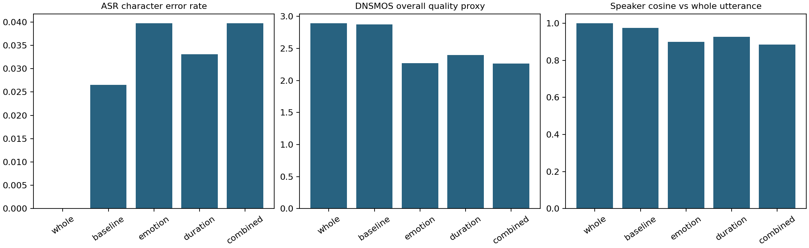
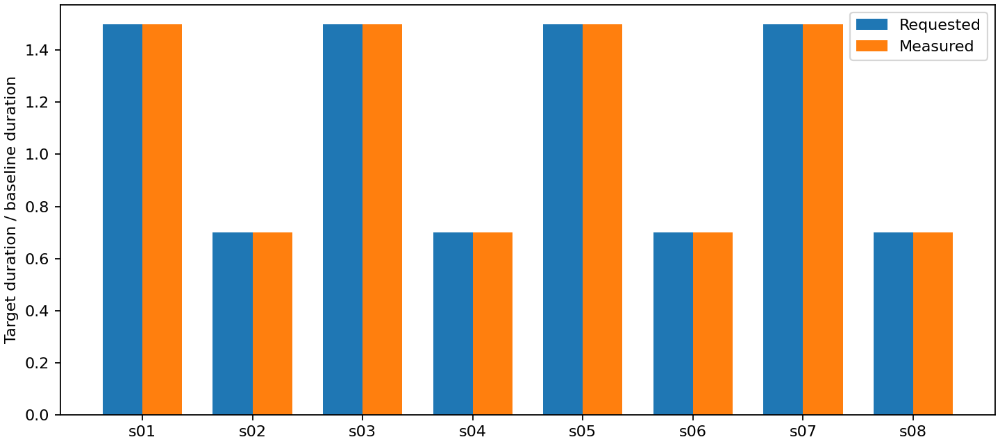
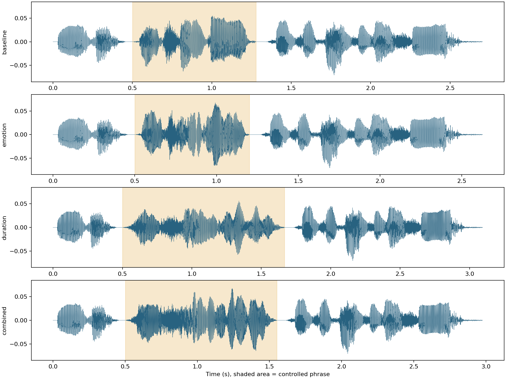
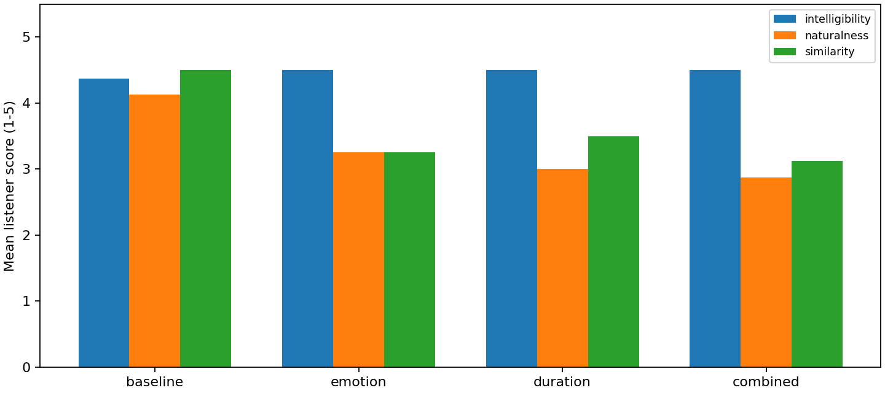

# 中文段内情感与时长可控语音合成实验说明

## 1. 实验目标与完成情况

我基于开源 MeloTTS 中文模型搭建了语音合成基线，使用 sherpa-onnx 在本地推理，在同一条输出语音中加入片段情感控制和指定词语、短语的时长控制。我采用显式控制信号，在配置文件中写出文本片段、情感类型和时长倍率。

我完成了 8 组中文测试句、5 种对照条件，共 40 条单声道 WAV 音频。默认测试覆盖平静转激动、激动转低落、低落转激动，以及词语和短语的拉长、缩短。所有音频、分段边界、原始识别文本和测量数据均保存在项目中。

## 2. 方法与实现

### 2.1 合成基线

我使用 `vits-melo-tts-zh_en`，固定单一中文女声、sid=0、speed=1，关闭 VITS 两项噪声采样参数。模型输出重采样到 22050 Hz。我缓存每个片段的原始浮点波形，使同一句的不同控制条件共享相同底层样本。原始模型与推理框架来自开源项目，我实现了控制流程、实验组织和评测代码。

我设置了整句原始合成和分段中性基线两种参考。整句参考保留完整文本上下文，分段基线与各控制条件使用相同切分。通过这两种参考，我可以观察切分和控制分别造成的影响。

### 2.2 句内情感控制

我将每个片段标记为 neutral、excited 或 sad。使用 WORLD 分解语音，修改有声帧的基频中位位置和变化范围，保留谱包络及非周期参数，再进行重合成。随后使用相位声码器改变片段时长，并乘以指定增益。

| 类型 | 基频位移 | 对数基频范围系数 | 增益设置 | 片段时长系数 |
|---|---|---|---|---|
| neutral | 0 半音 | 1.00 | 0 dB | 1.00 |
| excited | +2 半音 | 1.20 | +2 dB | 0.90 |
| sad | −1.5 半音 | 0.80 | −2 dB | 1.15 |

我把这一方法定位为基于韵律规则的情感控制基线。它能够直接控制基频、语速和能量相关参数，情感类别的感知效果仍然需要听众或情感识别模型验证。此版本尚未运行独立情感识别模型。

### 2.3 指定词语和短语的时长控制

我在文本配置中显式切出目标片段，并设置 `target=true`。时长系数 1.5 表示拉长到原片段的 150%，0.7 表示缩短到 70%。相位声码器的 rate 取时长系数的倒数，最后将输出长度修正到四舍五入后的目标采样点数。

这里的目标边界来自合成时的文本切分，目标时长是去除片段首尾低能量填充后的完整片段长度。单词在独立合成时可能具有自己的韵律和停顿。因此这些测量描述的是本系统定义的片段级时长控制，语音中的音素级真实边界需要进一步强制对齐。

联合控制时，最终时长系数等于显式时长倍率乘以情感配置的时长系数，例如 excited 与 1.5 倍叠加后为 1.35 倍。

### 2.4 边界处理

我对各片段两端施加 8 ms 淡入淡出，在相邻片段间插入固定 45 ms 间隔。所有条件使用同一 0.55 波形增益，保留条件间的相对响度变化。边界处理可以降低波形跳变，较短的词语仍可能听起来像单独发音。整个流程最终输出一条包含所有片段的 WAV。

## 3. 实验设置

我构造了 8 组测试句，各目标文本和倍率列在后面的时长控制表中。默认配置包含 4 个 1.5 倍目标和 4 个 0.7 倍目标，其中 s05 控制“安全第一”，s06 控制“马上出发”，s07 控制“谢谢”，s08 控制“开心”。前 4 组控制较长片段，并覆盖多种情感转换。

| 条件名 | 设置 |
|---|---|
| whole | 文本整体输入模型合成 |
| baseline | 各片段中性合成后拼接 |
| emotion | 对指定片段施加情感韵律参数 |
| duration | 只修改目标片段时长 |
| combined | 同时施加情感和时长控制 |

我使用本机 Windows、Python 3.9.1 和 CPU 推理完成本轮实验。本机有约 6 GB 显存的 RTX 4050，当前流程没有启用 CUDA，也没有重新训练模型。

- sherpa-onnx 2.0.1
- onnxruntime 1.19.2
- numpy 2.0.2
- scipy 1.13.1
- soundfile 0.13.1
- librosa 0.11.0
- pyworld 0.3.5
- matplotlib 3.9.4

## 4. 客观评价指标

我用中文 Zipformer-CTC int8 模型识别完整输出语音，去除空格和标点后计算字符编辑距离。语料级 CER 等于全部字符编辑距离之和除以全部参考字符数。本实验每个条件有 151 个参考字符。CER 受识别器本身影响，数值用于比较文本可恢复程度。

我用 WeSpeaker 中文 CN-Celeb ResNet34 提取说话人向量，计算控制语音与同文本整句原始合成的余弦相似度。它衡量本轮控制对原模型音色的保持程度。whole 与自身相比为 1.0，这是参考定义产生的结果。

我用 DNSMOS 的非个性化模型计算 SIG 和 OVRL，采用官方的 9.01 秒窗口和多项式标定。短音频按官方流程重复扩展后评分。DNSMOS 原本用于语音质量评价，在本实验中作为失真和整体质量的客观代理。合成语音自然度、情感转折流畅度需要结合主观评分分析，DNSMOS 与人工自然度分数的含义存在差别。

我还统计目标片段长度比、片段基频中位数、RMS 电平和削波比例。

## 5. 基本要求的结果分析

### 5.1 可懂度、质量与音色保持

| 条件 | 音频数 | CER ↓ | DNSMOS SIG ↑ | DNSMOS OVRL ↑ | 说话人余弦相似度 ↑ |
|---|---|---|---|---|---|
| 整句原始合成 | 8 | 0.00% | 3.497 | 2.892 | 1.000 |
| 分段中性基线 | 8 | 2.65% | 3.447 | 2.873 | 0.975 |
| 句内情感控制 | 8 | 3.97% | 3.018 | 2.271 | 0.899 |
| 目标时长控制 | 8 | 3.31% | 3.219 | 2.394 | 0.927 |
| 情感与时长联合控制 | 8 | 3.97% | 2.915 | 2.264 | 0.884 |

整句参考的 CER 为 0.00%，分段基线出现了 4 个字符编辑错误。以下列出分段基线识别有误的样本，便于对照原音频定位问题。

| 样本 | 参考文本 | 识别文本 | 字符编辑距离 |
|---|---|---|---|
| s07 | 我只想再说一次，谢谢你一直陪在我的身边。 | 我只想再说一次你一直陪在我的身边 | 2 |
| s08 | 听到结果以后，开心的感觉一下子涌上心头。 | 听到结果以后的感觉一下子涌上心头 | 2 |

默认测试中，s07 的“谢谢”和 s08 的“开心”在分段条件下被识别器遗漏。短词独立合成可能影响上下文连贯性和可懂度，需要结合音频核查。

时长控制的 CER 为 3.31%，共 5 个字符编辑错误。情感控制的 CER 为 3.97%，联合控制为 3.97%。我保留逐条识别文本，用于定位局部错字和漏字。这组测试的规模有限，跨文本稳定性需要扩展测试集验证。

分段基线的说话人相似度为 0.975，情感控制后降到 0.899，联合控制进一步降到 0.884。DNSMOS OVRL 也由分段基线的 2.873 降到情感条件的 2.271。WORLD 重合成、基频修改和时域伸缩可能引入音色变化及失真，客观结果支持继续检查这些环节。

### 5.2 时长控制精度

| 样本 | 目标片段 | 基线秒数 | 控制后秒数 | 指定倍率 | 实测倍率 |
|---|---|---|---|---|---|
| s01 | 没想到我们真的成功了！ | 1.6486 | 2.4729 | 1.50 | 1.5000 |
| s02 | 现在终于轮到我们上场了！ | 1.8112 | 1.2678 | 0.70 | 0.7000 |
| s03 | 但我突然想起了离开的朋友。 | 2.0434 | 3.0650 | 1.50 | 1.5000 |
| s04 | 不过我们还有重新开始的机会！ | 2.1827 | 1.5279 | 0.70 | 0.7000 |
| s05 | 安全第一 | 0.7779 | 1.1668 | 1.50 | 1.5000 |
| s06 | 马上出发 | 0.7895 | 0.5527 | 0.70 | 0.7000 |
| s07 | 谢谢 | 0.3019 | 0.4528 | 1.50 | 1.5000 |
| s08 | 开心 | 0.3135 | 0.2194 | 0.70 | 0.6999 |

8 个目标的实测倍率与设定值保持一致。全部控制条件中，采样点取整产生的最大倍率误差为 0.00006366，验证程序对 52 个未施加控制的片段完成逐采样一致性检查。这一结果验证了局部修改范围和指定长度的实现。听感自然度仍取决于片段发音和连接方式。

### 5.3 情感相关声学变化

下表针对相同文本片段配对比较，先求各片段相对分段基线的基频中位数比和 RMS 差值，再按情感求平均。

| 情感设置 | 片段数 | 实测基频中位数比 | 实测 RMS 差值 dB |
|---|---|---|---|
| excited | 7 | 1.121 | -0.539 |
| sad | 3 | 0.924 | -4.876 |

基频变化可以用于检查声学控制方向。输出 RMS 同时受到重合成、时长变化和淡入淡出的影响，因此增益参数的设置值与实测电平变化会有差别。声学参数测量尚不足以确认听众能否正确感知“激动”或“低落”，这部分需要独立感知验证。

### 5.4 主观评测

本轮收集了 1 名听众的完整评分，每名听众评价 32 条音频。以下数值是先计算每名听众在同一条件下的平均分，再对听众平均得到的结果。小样本结果仅用于本轮初步比较。

| 条件 | 可懂度 | 自然度 | 音色相似度 |
|---|---|---|---|
| 分段中性基线 | 4.375 | 4.125 | 4.500 |
| 句内情感控制 | 4.500 | 3.250 | 3.250 |
| 目标时长控制 | 4.500 | 3.000 | 3.500 |
| 情感与时长联合控制 | 4.500 | 2.875 | 3.125 |

原始评分文件与 `results/subjective_summary.csv` 一起保留，便于核查。

分段基线自然度为 4.125 分，情感控制为 3.250 分，联合控制为 2.875 分。音色相似度也由分段基线的 4.500 分变化到联合控制的 3.125 分。这与客观质量和说话人向量相似度下降的方向一致，说明控制过程引入的失真和音色变化值得继续改进。可懂度在各控制条件下仍保持较高评分，识别器的 CER 与人工听感提供了互补观察。

本轮听众人数较少，结果用于描述本次试听观察，尚不足以估计听众群体差异或进行可靠显著性检验。

试听以同文本整句合成为音色参考，隐藏条件名称并用固定随机种子打乱 32 条待评音频的顺序。量表为 1 很差、2 较差、3 一般、4 较好、5 很好。本轮量表评价三项基本质量指标，情感类别识别准确率和情感边界流畅度需要单独设计后续听辨实验。

## 6. 局限与后续实验入口

我实现的基线能够在一句输出中组合不同韵律情感设置，并精确修改指定片段的时长。主要局限集中在短词独立合成的上下文损失、WORLD 重合成的音色变化，以及固定间隔拼接的转折自然度。

我保留了原始波形缓存、边界标注和逐条指标，后续可以直接复用同一套测试句。可进一步比较完整句子合成后强制对齐再编辑、边界平滑、或模型内部的局部韵律控制。任何改进都需要在同一组音频条件和评价口径下重新测量。

## 7. 结果文件对应关系

| 文件 | 内容 |
|---|---|
| results/audio/ | 40 条实际生成的 WAV |
| results/manifest.json | 文本、条件、音频路径和采样点边界 |
| results/objective_metrics.csv | 逐条识别文本、CER、DNSMOS、说话人相似度 |
| results/segment_metrics.csv | 片段时长、倍率、基频中位数、RMS |
| results/summary.json | 按条件汇总的客观结果 |
| results/verification.json | 波形与时长检查结果 |
| results/listening.html | 离线主观试听与评分导出 |
| results/blind_key.json | 试听编号和条件的对应关系 |
| results/subjective_summary.csv | 导入真实评分后生成的主观汇总 |
| results/figures/ | 可复用的实验图 |
| models/sources.json | 模型下载来源和本轮文件 SHA-256 |

## 8. 开源来源

- MeloTTS 模型与项目，https://github.com/myshell-ai/MeloTTS 。模型包内保留原 LICENSE。
- sherpa-onnx 中文合成模型说明，https://k2-fsa.github.io/sherpa/onnx/tts/pretrained_models/vits.html 。
- 中文 Zipformer-CTC 模型说明，https://k2-fsa.github.io/sherpa/onnx/pretrained_models/offline-ctc/icefall/zipformer.html 。
- WeSpeaker 项目，https://github.com/wenet-e2e/wespeaker 。模型发布来源见 models/sources.json。
- WORLD 声码器，https://github.com/mmorise/World 。
- librosa 时长伸缩接口，https://librosa.org/doc/latest/generated/librosa.effects.time_stretch.html 。
- DNSMOS 官方实现，https://github.com/microsoft/DNS-Challenge/tree/master/DNSMOS 。我使用其公开模型和非个性化标定方式，评分实现保留了官方方法的窗口与校准设置。
